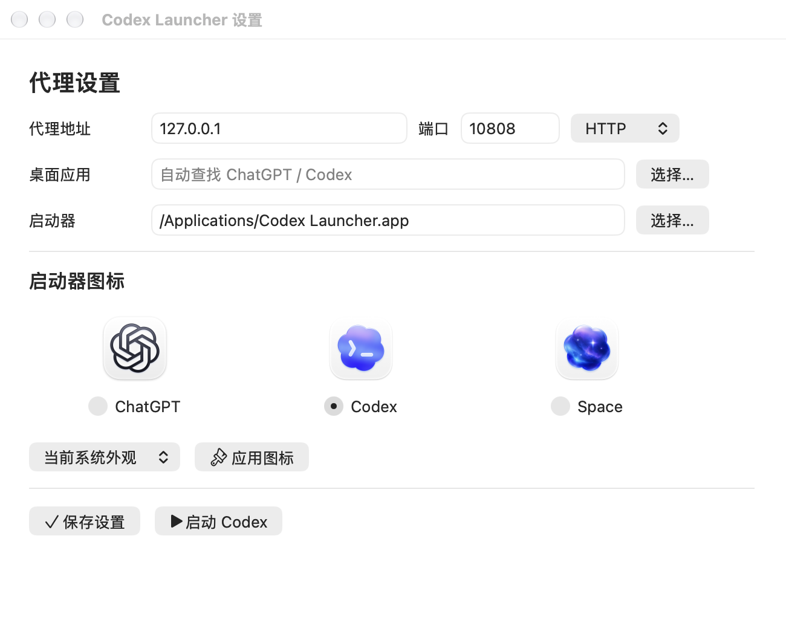

# codex-local-proxy-launcher

[中文](#中文) | [English](#english)

<a id="中文"></a>

为 macOS 和 Windows 上的 Codex 桌面端提供的本地代理启动器，兼容新版 ChatGPT 和旧版 Codex。它只为自己启动的应用设置代理，不会修改系统代理、TUN 路由、注册表，也不会改动 ChatGPT/Codex 的配置。

如果你已经开启了本地代理，桌面端却仍然无法连接、反复显示 `Reconnecting` 或 WebSocket 连接失败，可以试试这个工具。它本身不是代理客户端，需要配合 v2rayN、Clash 等代理工具使用。

## 下载

前往 **[最新 Release](https://github.com/Mark8924/codex-local-proxy-launcher/releases/latest)**，下载对应系统的 ZIP 包，解压后即可使用。`SHA256SUMS` 提供各下载包的校验值。

## macOS

### 安装与启动

1. 把 `macos/Codex Launcher.app` 放到固定位置，例如“应用程序”文件夹。升级旧版时，请替换整个 `.app`。
2. 如需修改代理（默认 `127.0.0.1:10808`），打开 `macos/Codex Launcher Settings.app`，填写地址和端口后保存。应用路径留空时，会自动查找 ChatGPT/Codex。
3. 先启动代理客户端，再完全退出 ChatGPT/Codex，然后点击 `Codex Launcher.app` 启动。可以把它拖进 Dock，以后直接从这里打开。

### 设置窗口

**设置窗口是独立的工具，正常启动时不会弹出。** 保存一次后，继续使用原来的启动器即可，无需手动编辑配置文件。建议将设置应用与启动器一并保留。

窗口上方是代理设置，修改端口后点击 **保存设置**；下方用于更换启动器图标，选择样式后点击 **应用图标**（详见下一节）。设置应用本身使用带扳手的定制图标，方便与主启动器区分。



### 更换启动器图标

在设置窗口中选择 **ChatGPT**、**Codex** 或 **Space**，然后点击 **应用图标**。操作前请确认“启动器”一栏指向你实际使用的 `.app`，尤其是已固定到 Dock 的那一个。

- **图标来源**：三套图标都取自本机已安装的 ChatGPT，项目既不打包，也不在线下载。旧版应用如果缺少某套图标资源，会直接报错。
- **影响范围**：只更换启动器的图标，不修改 ChatGPT 本身，也不需要关闭正在使用的 ChatGPT。
- **浅色与深色**：Codex 和 Space 默认采用更换时的系统外观，也可以指定浅色或深色；之后不会随系统外观自动切换。
- **安全替换**：先在临时副本中生成图标、签名并校验，通过后才替换，失败时回滚。应用目录和 Dock 固定入口保持不变。
- **权限与缓存**：启动器位于受保护目录时，可能需要管理员确认。Finder 和 Dock 有图标缓存，新图标可能稍后才显示；工具不会重启 Dock。

此外仍保留了用于选择图标的 `Change Codex Icon.command` 脚本，以及原有的自动获取方式 `Install Codex Icon.command`。

### 签名与系统权限

两个 `.app` 都是原生 universal 应用，同时支持 Apple Silicon 和 Intel，无需 Rosetta、Python 或其他运行时。它们使用本地 ad-hoc 签名，**没有 Developer ID 签名，也未经过公证（notarize）**。如果 macOS 拦截了下载的应用，请先确认应用来源，再按系统提示在“隐私与安全性”中允许打开。

如果手动修改过启动器包内的文件，可以运行 `Sign Codex Launcher.command` 重新签名。签名前，脚本会清理妨碍签名的 Finder 图标元数据；它不会清除 quarantine，也不会修改系统安全设置。

## Windows

1. 完整解压 `windows` 文件夹，不要把其中的脚本拆散。
2. 如需修改代理（默认 `127.0.0.1:10808`），双击 `Open Launcher Settings.cmd`，填写地址和端口后保存。桌面应用路径可以留空，会自动查找。
3. 先启动代理客户端，再完全退出 ChatGPT/Codex，然后双击 `Launch Codex With Proxy.cmd`。

正常启动不会打开设置窗口，也无需手动编辑配置。支持 Windows PowerShell 5.1 和 PowerShell 7，也支持从 Microsoft Store 安装的新版 ChatGPT 和旧版 Codex。

如需创建桌面快捷方式，请运行：

```powershell
powershell -NoProfile -ExecutionPolicy Bypass -File .\windows\Create-Codex-Launcher-Shortcut.ps1
```

Windows 设置窗口提供代理配置和端口检测。三套官方图标的切换目前仅在 macOS 版中提供，因此 Windows 设置窗口不会显示这个无法使用的选项。

## 常见问题

**代理端口应该填什么？**
填写代理客户端的 HTTP 或 mixed 端口，不要填纯 SOCKS 端口。默认的 `10808` 是 v2rayN 的常见端口，Clash 类客户端也常用 `7890`；请以你自己客户端中的设置为准。

**提示代理未监听？**
确认代理客户端已经打开，并且地址和端口填写正确。在 Windows 上，可以在设置窗口中点击 **检测代理**。

**提示 ChatGPT/Codex 已在运行？**
请彻底退出应用（包括后台或系统托盘中的进程）后再启动。代理环境只能传给新启动的进程，无法注入已经在运行的应用。更换启动器图标不受此限制。

**设置保存在哪里？**
工具只保存自己的用户设置，不修改系统网络配置：

- macOS：`~/Library/Application Support/codex-local-proxy-launcher/`
- Windows：`%APPDATA%\codex-local-proxy-launcher\`

正常使用时不需要打开这些文件。

**关闭代理后，其他软件会断网吗？**
不会因为这个启动器而断网。代理变量只传给它启动的 ChatGPT/Codex 进程，既不设置全局环境变量，也不会改变调用它的 PowerShell 环境。

<details>
<summary>命令行用法与旧版配置兼容</summary>

原有的脚本、端口参数和 `.env` 配置仍然可用。优先级从高到低依次为：显式设置的进程环境变量、图形界面设置、旧版配置。

```bash
./macos/Launch\ Codex\ With\ Proxy.command 7890
./macos/Install\ Codex\ Icon.command --style space --app "/Applications/Codex Launcher.app"
```

```powershell
.\windows\Launch-Codex-With-Proxy.ps1 -ProxyPort 7890
```

`CODEX_PROXY_URL` 会覆盖单独设置的主机、端口和协议。它接受完整的代理地址，支持 HTTP/HTTPS、认证信息以及用方括号括起的 IPv6 地址；地址中的特殊字符需要进行 URL 编码。

使用旧版配置时，可以先复制示例文件再编辑：

```bash
cp codex-proxy-launcher.env.example codex-proxy-launcher.env
nano codex-proxy-launcher.env
```

也可以新建用户级配置：

```bash
nano ~/.codex-proxy-launcher.env
```

在 Windows 上：

```powershell
notepad "$env:USERPROFILE\.codex-proxy-launcher.env"
```

旧版配置按以下顺序读取，排在前面的优先：

1. 环境变量 `CODEX_PROXY_CONFIG` 指定的文件
2. 平台目录（`macos/` 或 `windows/`）中的 `codex-proxy-launcher.env`
3. 仓库根目录中的 `codex-proxy-launcher.env`
4. 用户主目录中的 `.codex-proxy-launcher.env`

如果显式指定的应用路径无效，启动器会直接报错，而不会悄悄启动另一个安装。

</details>

## 开发

macOS 设置界面的源码位于 `macos/settings/`，基于系统自带的 AppKit，不依赖 Electron。重新构建 universal 设置应用并运行 macOS 测试：

```bash
zsh scripts/build_macos_settings.zsh
python3 -m unittest discover -s tests -p 'test_macos.py' -v
```

Windows 设置界面基于系统自带的 WinForms。GitHub Actions 覆盖 macOS、Windows PowerShell 5.1 和 PowerShell 7。发布包由 `scripts/package_release.py` 仅从已提交的文件生成，不包含本机设置或官方图标。

## 免责声明

本项目为非官方项目，与 OpenAI 无隶属关系。Codex、ChatGPT、OpenAI 及相关图标归各自权利人所有。本项目采用 MIT 许可证。

---

<a id="english"></a>

A local proxy launcher for the Codex desktop app on macOS and Windows, compatible with both the current ChatGPT app and legacy Codex. It applies a proxy only to the app it launches, and does not change your system proxy settings, TUN routes, registry or ChatGPT/Codex configuration.

It is intended for cases where your local proxy is already running but the desktop app still cannot connect, keeps showing `Reconnecting`, or fails on WebSocket connections. It is not a proxy client itself and must be used with one, such as v2rayN or Clash.

## Download

Go to the **[latest Release](https://github.com/Mark8924/codex-local-proxy-launcher/releases/latest)**, download the ZIP for your platform, and extract it. `SHA256SUMS` contains checksums for the downloads.

## macOS

### Install and launch

1. Move `macos/Codex Launcher.app` somewhere permanent, such as Applications. When upgrading, replace the entire `.app`.
2. To change the proxy (default `127.0.0.1:10808`), open `macos/Codex Launcher Settings.app`, enter the host and port, and save. Leave the app path empty to find ChatGPT/Codex automatically.
3. Start your proxy client, fully quit ChatGPT/Codex, then open `Codex Launcher.app`. You can drag it to the Dock and launch from there from then on.

### Settings window

**Settings is a separate tool and never opens during normal launching.** Save once, then keep using your original launcher; no manual config editing is needed. We recommend keeping the settings app together with the launcher.

The top of the window holds the proxy settings: after editing the port, click **Save Settings**. The bottom changes the launcher icon: select a style and click **Apply Icon** (see the next section). The settings app itself has a custom wrench icon, so it is easy to tell apart from the main launcher.


### Changing the launcher icon

In the settings window, choose **ChatGPT**, **Codex** or **Space**, then click **Apply Icon**. First check that the **Launcher** field points to the `.app` you actually use, particularly one pinned to the Dock.

- **Source**: all three icons come from the ChatGPT app installed on your Mac; they are neither bundled nor downloaded. If an older installation is missing one of the icon sets, an error is reported.
- **Scope**: only the launcher's icon changes. ChatGPT itself is not modified and does not need to be closed.
- **Light and dark**: Codex and Space follow the system appearance at the time you apply them, or you can choose light or dark explicitly. They do not change automatically when the system appearance changes later.
- **Safe replacement**: the icon is generated, signed and verified in a temporary copy before it replaces the launcher, with rollback on failure. The app directory and Dock pin stay in place.
- **Permissions and caching**: protected folders may require administrator approval. Finder and the Dock cache icons, so the new icon may take a moment to appear; the tool does not restart the Dock.

The `Change Codex Icon.command` icon-picker script and the original automatic `Install Codex Icon.command` are also still available.

### Signing and macOS security

Both `.app` bundles are native universal apps for Apple Silicon and Intel, and need no Rosetta, Python or other runtime. They are ad-hoc signed locally and are **not Developer ID signed or notarized**. If macOS blocks the downloaded app, confirm where it came from, then allow it in Privacy & Security as prompted.

If you modify files inside the launcher bundle by hand, run `Sign Codex Launcher.command` to re-sign it. Before signing, it removes Finder icon metadata that would otherwise break signing; it does not remove quarantine or change system security settings.

## Windows

1. Extract the complete `windows` folder and keep its scripts together.
2. To change the proxy (default `127.0.0.1:10808`), double-click `Open Launcher Settings.cmd`, enter the host and port, and save. Leave the desktop app path empty for automatic discovery.
3. Start your proxy client, fully quit ChatGPT/Codex, then double-click `Launch Codex With Proxy.cmd`.

Normal launching does not open the settings window, and no manual config editing is needed. Windows PowerShell 5.1 and PowerShell 7 are supported, as are the current ChatGPT and legacy Codex apps installed from the Microsoft Store.

To create a desktop shortcut, run:

```powershell
powershell -NoProfile -ExecutionPolicy Bypass -File .\windows\Create-Codex-Launcher-Shortcut.ps1
```

The Windows settings window provides proxy configuration and port checking. Choosing among the three official icons is currently available only on macOS, so the Windows settings window does not show that unusable option.

## FAQ

**Which proxy port should I use?**
Use your proxy client's HTTP or mixed port, not a SOCKS-only port. The default `10808` is common for v2rayN, and Clash-style clients often use `7890`; check the settings in your own client.

**Getting a "proxy is not listening" message?**
Make sure your proxy client is running and the host and port are correct. On Windows, you can click **Test proxy** in the settings window.

**Getting a "ChatGPT/Codex is already running" message?**
Fully quit the app, including any instance in the background or system tray, then launch again. The proxy environment can only be passed to a new process; it cannot be injected into an app that is already running. Changing the launcher icon is not subject to this restriction.

**Where are settings stored?**
The tool stores only its own user settings and does not change system network configuration:

- macOS: `~/Library/Application Support/codex-local-proxy-launcher/`
- Windows: `%APPDATA%\codex-local-proxy-launcher\`

You do not need to open these files in normal use.

**Will other apps lose network access when the proxy is off?**
Not because of this launcher. Proxy variables are passed only to the ChatGPT/Codex process it starts. It sets no global environment variables and does not change the PowerShell environment that calls it.

<details>
<summary>Command line and legacy configuration</summary>

The existing scripts, port arguments and `.env` configuration still work. Priority, from highest to lowest: explicitly set process environment variables, graphical settings, legacy configuration.

```bash
./macos/Launch\ Codex\ With\ Proxy.command 7890
./macos/Install\ Codex\ Icon.command --style space --app "/Applications/Codex Launcher.app"
```

```powershell
.\windows\Launch-Codex-With-Proxy.ps1 -ProxyPort 7890
```

`CODEX_PROXY_URL` overrides the separate host, port and scheme settings. It takes a full proxy URL and supports HTTP/HTTPS, credentials and bracketed IPv6 addresses; special characters in the URL must be URL-encoded.

To use a legacy config file, copy the example and edit it:

```bash
cp codex-proxy-launcher.env.example codex-proxy-launcher.env
nano codex-proxy-launcher.env
```

Or create a per-user config:

```bash
nano ~/.codex-proxy-launcher.env
```

On Windows:

```powershell
notepad "$env:USERPROFILE\.codex-proxy-launcher.env"
```

Legacy configuration is read in the following order, with earlier entries taking priority:

1. The file specified by the `CODEX_PROXY_CONFIG` environment variable
2. `codex-proxy-launcher.env` in the platform folder (`macos/` or `windows/`)
3. `codex-proxy-launcher.env` in the repository root
4. `.codex-proxy-launcher.env` in your home directory

If an explicitly specified app path is invalid, the launcher reports an error rather than silently launching a different installation.

</details>

## Development

The macOS settings UI source is in `macos/settings/`. It is built on the system's AppKit framework, with no Electron dependency. To rebuild the universal settings app and run the macOS tests:

```bash
zsh scripts/build_macos_settings.zsh
python3 -m unittest discover -s tests -p 'test_macos.py' -v
```

The Windows settings UI uses the system's WinForms. GitHub Actions covers macOS, Windows PowerShell 5.1 and PowerShell 7. Release packages are generated by `scripts/package_release.py` from committed files only, and exclude local settings and official icons.

## Disclaimer

This is an unofficial project and is not affiliated with OpenAI. Codex, ChatGPT, OpenAI and related icons belong to their respective owners. Licensed under the MIT License.
