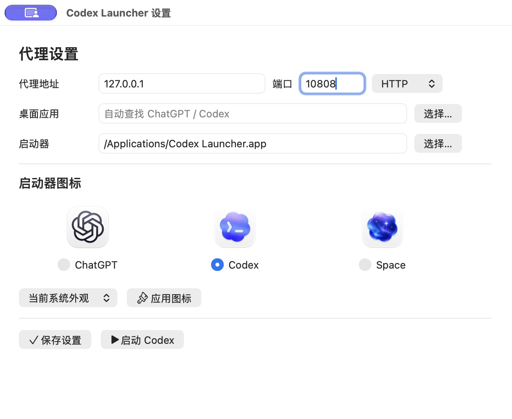

# codex-local-proxy-launcher

[中文](#中文) | [English](#english)

<a id="中文"></a>

适用于 macOS 和 Windows 的 Codex 桌面端本地代理启动器，兼容新版 ChatGPT 和旧版 Codex。只为启动的应用设置代理，不修改系统代理、TUN 路由、注册表或 ChatGPT/Codex 配置。

适合已开本地代理，但桌面端仍无法连接、反复 `Reconnecting` 或 WebSocket 失败的情况。它不是代理客户端，需要配合 v2rayN、Clash 等工具使用。

**下载：[最新 Release](https://github.com/Mark8924/codex-local-proxy-launcher/releases/latest)**。按系统选择 ZIP，解压后使用；`SHA256SUMS` 提供下载包校验值。

## macOS

1. 把 `macos/Codex Launcher.app` 放到常用位置，例如“应用程序”。升级旧版时替换完整的 `.app`。
2. 修改代理时，打开 `macos/Codex Launcher Settings.app`，填写地址、端口并保存。默认 `127.0.0.1:10808`；应用路径留空时自动查找 ChatGPT/Codex。
3. 先启动代理客户端，再完全退出 ChatGPT/Codex，点击 `Codex Launcher.app` 启动。可以把它拖进 Dock，以后直接点击这个入口。

**设置窗口是独立工具，不会在正常启动时弹出。** 保存一次后，继续使用原来的启动器即可，不需要编辑配置文件。建议把设置应用和启动器一起保留。

在窗口上方修改端口后，点击 **保存设置**；更换图标则在下方选择样式，点击 **应用图标**。



### 换图标

打开设置窗口，在 **ChatGPT、Codex、Space** 中选一个，点击“应用图标”。确认“启动器”一栏指向你实际使用的 `.app`，尤其是已固定到 Dock 的版本。

- 图标来自本机已安装的 ChatGPT，不打包、不在线下载；旧版应用缺少某套资源时会报错。
- 只更换启动器图标，不修改 ChatGPT 本身，不需要关闭正在使用的 ChatGPT。
- Codex、Space 默认采用切换时的系统外观，也可指定浅色或深色；之后不会随系统外观自动变化。
- 在临时副本中生成图标、签名并校验后才替换，失败时回滚。应用目录及 Dock 固定入口保持不变。
- 受保护目录可能需要管理员确认。Finder/Dock 有图标缓存，显示可能稍后刷新；工具不会重启 Dock。

也保留了 `Change Codex Icon.command` 图标选择脚本，以及原来的 `Install Codex Icon.command` 自动获取方式。

### macOS 权限

两个 `.app` 都是支持 Apple Silicon 和 Intel 的原生 universal 应用，不需要 Rosetta、Python 或额外运行时。使用本地 ad-hoc 签名，**不是 Developer ID 签名，也未 notarize**。如 macOS 拦截下载的应用，请按系统提示在“隐私与安全性”中确认来源后打开。

如果手动修改了启动器包内的文件，可运行 `Sign Codex Launcher.command` 重新签名。签名前会清理阻碍签名的 Finder 图标元数据，不会清除 quarantine 或修改系统安全设置。

## Windows

1. 将 `windows` 文件夹完整解压，脚本不要拆散。
2. 修改代理时，双击 `Open Launcher Settings.cmd`，填写地址、端口并保存。默认 `127.0.0.1:10808`；桌面应用路径可留空自动查找。
3. 启动代理客户端，完全退出 ChatGPT/Codex 后，双击 `Launch Codex With Proxy.cmd`。

正常启动不会打开设置窗口，也不需要手动编辑配置。支持 Windows PowerShell 5.1、PowerShell 7，以及 Microsoft Store 安装的新版 ChatGPT / 旧版 Codex。

需要桌面快捷方式时，运行：

```powershell
powershell -NoProfile -ExecutionPolicy Bypass -File .\windows\Create-Codex-Launcher-Shortcut.ps1
```

Windows 设置窗口支持代理配置和端口检测。三套官方图标的选择目前仅提供 macOS 版，不会在 Windows 上显示无效选项。

## 常见问题

**代理端口怎么填？** 使用代理客户端的 HTTP 或 mixed 端口，不要填纯 SOCKS 端口。默认是 v2rayN 常见的 `10808`；Clash 类客户端也常用 `7890`，以自己的客户端设置为准。

**提示代理未监听？** 确认代理客户端已打开，地址和端口正确。Windows 设置窗口可点击“检测代理”。

**提示 ChatGPT/Codex 已运行？** 完全退出后台或托盘里的应用再启动。新的代理环境只能传给新进程，不能注入已经运行的应用。更换启动器图标不受此限制。

**设置保存在哪里？** 工具只保存自己的用户设置，不修改系统网络配置：macOS 使用 `~/Library/Application Support/codex-local-proxy-launcher/`，Windows 使用 `%APPDATA%\codex-local-proxy-launcher\`。正常使用不需要打开这些文件。

**代理关闭后其他软件会断网吗？** 不会因为这个启动器而断网。代理变量只传给它启动的 ChatGPT/Codex 进程，不设置全局环境变量，也不改变调用它的 PowerShell 环境。

<details>
<summary>命令行与旧版配置兼容</summary>

原来的脚本、端口参数和 `.env` 配置继续可用。图形设置优先于旧配置，显式进程环境变量优先于图形设置。

```bash
./macos/Launch\ Codex\ With\ Proxy.command 7890
./macos/Install\ Codex\ Icon.command --style space --app "/Applications/Codex Launcher.app"
```

```powershell
.\windows\Launch-Codex-With-Proxy.ps1 -ProxyPort 7890
```

`CODEX_PROXY_URL` 覆盖单独的主机、端口和协议设置。完整地址支持 HTTP/HTTPS、认证信息及方括号包裹的 IPv6；特殊字符需做 URL 编码。

旧配置可用 `cp codex-proxy-launcher.env.example codex-proxy-launcher.env` 复制，再用 `nano codex-proxy-launcher.env` 编辑；也可用 `nano ~/.codex-proxy-launcher.env` 新建用户配置。Windows 可运行 `notepad "$env:USERPROFILE\.codex-proxy-launcher.env"`。

旧配置项按 `CODEX_PROXY_CONFIG` 指定文件、平台目录、仓库根目录、用户主目录的顺序读取。显式应用路径无效时会报错，不会悄悄启动另一个安装。

</details>

## 开发

macOS 设置界面的源码在 `macos/settings/`，使用系统 AppKit，不依赖 Electron。重新构建 universal 设置应用：

```bash
zsh scripts/build_macos_settings.zsh
python3 -m unittest discover -s tests -p 'test_macos.py' -v
```

Windows 设置界面使用系统 WinForms。GitHub Actions 覆盖 macOS、Windows PowerShell 5.1 和 PowerShell 7。发布包由 `scripts/package_release.py` 从已提交文件生成，不包含本机设置或官方图标。

## 免责声明

非官方项目，与 OpenAI 无隶属关系。Codex、ChatGPT、OpenAI 及相关图标属于各自权利人。本项目使用 MIT 许可。

---

<a id="english"></a>

A cross-platform local proxy launcher for Codex Desktop, compatible with the current ChatGPT app and legacy Codex. It sets proxy variables only for the app it launches, without changing system proxy settings, TUN routes, registry keys or ChatGPT/Codex configuration.

**[Download the latest Release](https://github.com/Mark8924/codex-local-proxy-launcher/releases/latest)** and extract the ZIP for your platform. Checksums are included in `SHA256SUMS`. A separate proxy client such as v2rayN or Clash is required.

## macOS

1. Put `macos/Codex Launcher.app` somewhere permanent, such as Applications. Replace the complete app when upgrading.
2. To change the proxy, open `Codex Launcher Settings.app`, enter the host and port, and save. Defaults are `127.0.0.1:10808`. Leave the desktop app path empty for automatic discovery.
3. Start your proxy client, fully quit ChatGPT/Codex, and open `Codex Launcher.app`. Pin this launcher to the Dock for normal use.

**Settings is a separate app. It never opens during normal launching.** Save once, then keep using your original launcher. No manual config editing is needed.

Edit the port at the top and click **Save Settings**. To change the icon, select a style below and click **Apply Icon**.


### Icons

In Settings, choose **ChatGPT, Codex or Space** and click **Apply Icon**. Check that the launcher path points to the app you actually use, particularly a Dock-pinned installation.

Assets come only from the locally installed ChatGPT app; they are not bundled or downloaded. Missing assets on older installations are reported. Only the launcher changes, not ChatGPT itself, which can keep running.

Codex and Space use the system appearance at change time, with optional light/dark overrides. They do not automatically change afterward. Changes are staged, signed and verified, with rollback on failure. The app directory and Dock pin stay in place. Protected folders may require administrator approval. Icon caches may refresh later; Dock is not restarted.

Both apps are native universal binaries for Apple Silicon and Intel, without Rosetta or extra runtimes. They are ad-hoc signed, **not Developer ID signed or notarized**. Review the source before approving a blocked download in macOS Privacy & Security.

`Change Codex Icon.command`, `Install Codex Icon.command` and `Sign Codex Launcher.command` remain available. Signing removes incompatible Finder icon metadata, not quarantine or system security protections.

## Windows

1. Extract the complete `windows` folder and keep its scripts together.
2. To change the proxy, double-click `Open Launcher Settings.cmd`, enter the host and port, and save. Defaults are `127.0.0.1:10808`; leave the desktop app path empty for automatic discovery.
3. Start your proxy client, fully quit ChatGPT/Codex, then double-click `Launch Codex With Proxy.cmd`.

Normal launching does not open Settings. Windows PowerShell 5.1, PowerShell 7 and Microsoft Store installations are supported. Run `Create-Codex-Launcher-Shortcut.ps1` to create a desktop shortcut.

The Windows settings window includes proxy configuration and port checking. Official three-style icon selection is currently macOS-only.

## Notes

Use an HTTP or mixed proxy port, not a SOCKS-only endpoint. `10808` and `7890` are common defaults, but check your own proxy client. Existing ChatGPT/Codex processes must fully exit before a new launch can inherit proxy variables; changing the launcher's icon does not require this.

Settings are stored only in the launcher's own user directory: `~/Library/Application Support/codex-local-proxy-launcher/` on macOS and `%APPDATA%\codex-local-proxy-launcher\` on Windows. No global proxy environment or registry changes are made.

Legacy scripts, port arguments and `.env` files remain supported. Process environment variables take priority, followed by graphical settings, then legacy config files. A full `CODEX_PROXY_URL` overrides separate host/port/scheme settings. It supports authenticated HTTP/HTTPS URLs and bracketed IPv6 addresses.

## Development

The macOS settings UI uses AppKit; rebuild it with `zsh scripts/build_macos_settings.zsh`. Windows uses WinForms. CI covers macOS, Windows PowerShell 5.1 and PowerShell 7. `scripts/package_release.py` packages committed files only, excluding local settings and official icon assets.

This unofficial project is not affiliated with OpenAI. Product names and icons belong to their respective owners. MIT licensed.
